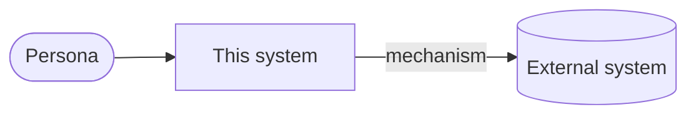

# Architecture Document

**Title:** [Product / system title]
**Date:** [Date]
**Status:** [Draft | In Review | Ready for design review | Approved]
**Source PRD:** `docs/PRD.md`, Status [PRD status when this was written], dated [PRD date]

### Approvals
| Role | Name | Date |
|------|------|------|
| [e.g. Client stakeholder] | [Name] | [Filled in by the approver] |
| [e.g. Delivery lead] | [Name] | [Filled in by the approver] |

## 1. Overview
[One paragraph: what the system is, its main parts, and how it meets the PRD's
objectives. Name the PRD; don't restate it.]

### System context (optional)
[Delete this subsection if a diagram adds nothing. Otherwise show the system,
its users and every external system from section 6, and nothing else.]

## 2. Constraints & Non-Negotiables
Every Non-Negotiable NFR from the PRD's Shared Contract, and how it is held.

| # | Constraint | Source | Held by |
|---|------------|--------|---------|
| 1 | [Constraint] | [PRD §8 → Non-Negotiable NFR name] | [ADR-NNNN and/or CONSTRAINTS.md → N-n] |

## 3. Technology Stack
| Layer | Technology | Version / Constraint | Decided in |
|-------|------------|----------------------|------------|
| Frontend | [Technology] | [Version/constraint] | [ADR-NNNN] |
| Backend | [Technology] | [Version/constraint] | [ADR-NNNN] |
| Database | [Technology] | [Version/constraint] | [ADR-NNNN] |
| Data access | [Technology] | [Version/constraint] | [ADR-NNNN] |
| Authentication | [Technology] | [Version/constraint] | [ADR-NNNN] |
| Background jobs / scheduling | [Technology or "None"] | [Version/constraint] | [ADR-NNNN] |
| Hosting / infrastructure | [Technology] | [Version/constraint] | [ADR-NNNN] |

### Constraints on future choices
[What this stack rules out or restricts for implementation, e.g. "no second
database", "server-rendered pages only".]

## 4. Component Architecture
### [Component name]
- Responsibility: [What this component owns]
- Boundaries: [What it explicitly does not own]
- Serves: [FR / NFR IDs]

## 5. Data Model
| Entity (PRD §8) | Owned by | Key attributes | Notes |
|-----------------|----------|----------------|-------|
| [Entity] | [This system / external source, read-only] | [Attributes] | [Derived fields, retention, audit] |

### Relationships
- [Entity A] 1—n [Entity B]: [meaning]

## 6. Integration Points
| Integration | Direction | Mechanism & schedule | Authentication | When it fails | PRD refs |
|-------------|-----------|----------------------|----------------|---------------|----------|
| [System] | [In / Out / Both] | [Mechanism, frequency] | [How] | [Behaviour, matching the PRD edge case] | [FR / NFR / edge case IDs] |

## 7. Deployment Topology
| Environment | Purpose | Hosting | Data |
|-------------|---------|---------|------|
| dev | [Purpose] | [Where] | [Synthetic / copy / none] |
| staging | [Purpose] | [Where] | [Data] |
| production | [Purpose] | [Where] | [Data] |

[Scheduled jobs, network boundaries, backups and restore.]

## 8. Observability
Serves: [availability NFR, and any NFR on timeliness of jobs or messages]

- **Logging:** [What is logged, in what format, where it goes, how long it is kept; no confidential data in logs]
- **Monitoring:** [Health checks and metrics that show the availability target is being met]
- **Alerting:** [What raises an alert, to whom, through which channel]
- **Failed scheduled jobs:** [How a job that fails or never runs is detected, and who is told]
- **Failed outbound messages:** [How a failed email or other send is detected, retried and reported]

## 9. Security & Compliance Baseline
- **Authentication:** [How users sign in; PRD refs]
- **Authorisation:** [Role model, and where each access rule from the PRD is enforced; FR IDs]
- **Data classification:** [Which entities are confidential or personal; how they are protected at rest and in transit]
- **Secrets:** [Where secrets live; who can read them]
- **Audit:** [What is recorded, where, for how long; PRD refs]
- **Compliance obligations:** [Law, contract or standard from the PRD, and how each is met]

## 10. NFR Mapping
| NFR (PRD §9) | Architectural approach | Trade-off recorded in |
|--------------|------------------------|-----------------------|
| [NFR] | [How the architecture meets it] | [ADR-NNNN or "None"] |

## 11. Decisions
| ADR | Title | Status |
|-----|-------|--------|
| [ADR-NNNN](adr/NNNN-title.md) | [Title] | [Proposed / Accepted / Superseded] |

## 12. Traceability
Every Shared Contract item, Non-Negotiable NFR, NFR and question routed to the
architect, and what addresses it.

| PRD item | Type | Addressed by |
|----------|------|--------------|
| [Entity / NFR / OQ #] | [Entity / Non-Negotiable NFR / NFR / Routed question] | [Section, ADR-NNNN, CONSTRAINTS.md → N-n] |

## 13. Risks from the PRD
Blocking PRD open questions, and what their answers could change here.

| PRD OQ | Could change | Current assumption | Cost if the answer differs |
|--------|--------------|--------------------|----------------------------|
| [#] | [Section / component / entity] | [What this draft assumes, or "None — left open"] | [Low / Medium / High, one line why] |

## 14. Dependencies
| # | Dependency | Type | Blocking? |
|---|-----------|------|-----------|
| 1 | [Dependency] | [Internal / External] | [Yes / No] |

## 15. Open Questions
Includes technology choices awaiting confirmation at design review, and
questions for the BA about the PRD (the PRD itself is never edited here).

| # | Question | Owner | Blocking? |
|---|----------|-------|-----------|
| 1 | [Question] | [Owner] | [Yes / No] |
